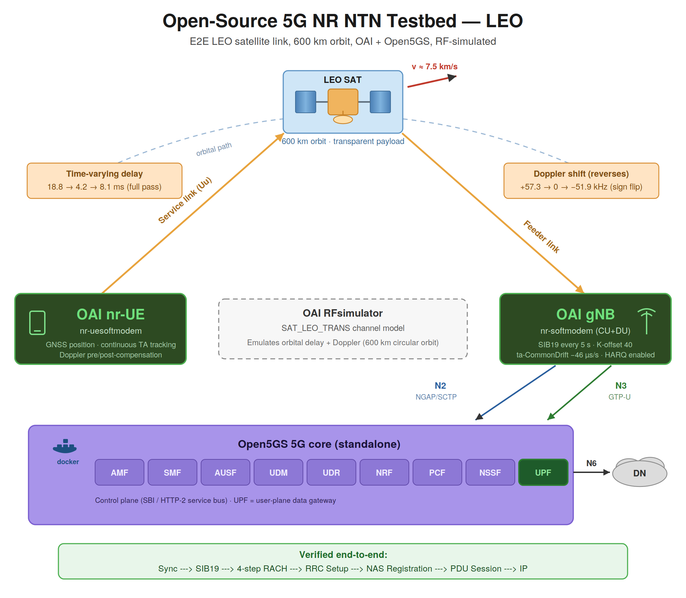
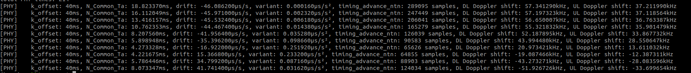
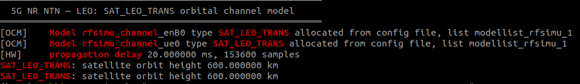
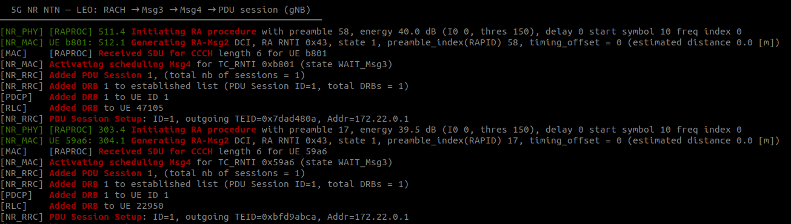

# Open-Source 5G NR NTN Testbed (LEO)

A reproducible, fully open-source **low-earth-orbit (LEO)** 5G NR Non-Terrestrial Network testbed, completing an end-to-end 3GPP Release-17 satellite attach across a full satellite pass, with propagation delay and Doppler shift tracked continuously as the satellite moves.

Built on **OpenAirInterface** and **Open5GS**, with the orbital channel emulated by OAI's RF simulator. No SDR hardware required.

> **Companion repository.** This repo covers the LEO-specific configuration and results. The build procedure, OAI patches, and 5G core deployment are shared with the GEO testbed: **[open-source-5g-ntn](https://github.com/sabbir-uoulu/open-source-5g-ntn)** (DOI [10.5281/zenodo.20588732](https://doi.org/10.5281/zenodo.20588732)). Start there, then return here for the LEO scenario.



---

## Validated capabilities

A complete Release-17 LEO NTN attach against a live 5G core:

**cell sync → SIB19 acquisition → 4-step RACH → RRC Setup → NAS registration → PDU session → IP connectivity**

### Delay and Doppler over one emulated pass

Unlike GEO, where the propagation delay is constant, LEO exercises the time-varying part of the Release-17 NTN toolkit. Across a single satellite pass the testbed tracked:

| Quantity | Start (rising) | Closest approach | End (receding) |
|---|---|---|---|
| One-way delay (feeder + service link) | 18.8 ms | **4.2 ms** | 8.1 ms |
| DL Doppler shift | +57.3 kHz | **≈ 0 (crossing)** | −51.9 kHz |
| NTN timing advance | 289,095 samples | 65,626 samples | 124,034 samples |
| Common TA drift | −46.1 µs/s | (sign change) | +41.7 µs/s |

The Doppler shift **crosses zero and reverses sign** as the satellite passes from approaching to receding. Orbital mechanics, visible directly in protocol state. The UE recomputes its timing advance continuously to follow it.



The orbital channel model is active on both link directions:



### Attach and session



---

## How LEO differs from GEO

Both scenarios run on the same binaries and the same three patches. The differences are entirely in configuration and in which Release-17 mechanisms get exercised.

| | GEO | LEO |
|---|---|---|
| Channel model | fixed `prop_delay` | `SAT_LEO_TRANS`, 600 km circular orbit |
| One-way delay (feeder + service link) | constant, 238.74 ms one-way | time-varying, 18.8 → 4.2 → 8.1 ms |
| Doppler | negligible | ±57 kHz, reverses sign |
| Cell-specific K-offset | 478 slots | 40 slots |
| `ta-CommonDrift` | not used | −46 µs/s (and its rate of change) |
| SIB19 validity | 240 s | 5 s (re-read every ~2.5 s) |
| HARQ feedback | **disabled** (Rel-17 NTN feature) | **enabled**, 38 ms RTT makes feedback practical |
| PRACH config index | 7 | 98 |
| NTN-aware RAR window patch | **required** | not required, RTT fits the base window |

Two findings worth stating explicitly:

- **HARQ feedback disabling is orbit-dependent, not an NTN blanket rule.** It is necessary at GEO round-trip times and unnecessary at LEO's.
- **The RAR-window patch written for GEO is not needed at LEO.** A GEO round trip (~477 ms) exceeds the base `ra-ResponseWindow` maximum of 80 ms; a LEO round trip (~14 ms) does not. The patch remains applied here and is harmless, but this confirms it addresses a GEO-scale problem specifically.

---

## Reproduce it

> Prerequisites: complete the build in the [GEO repository](https://github.com/sabbir-uoulu/open-source-5g-ntn) first. OAI pinned at tag `2026.w16` with the three patches applied, and the Open5GS core deployed. Then apply the LEO configuration below.

### 1. Core network

Bring up the same Open5GS deployment used for GEO, with the same subscriber provisioned (IMSI `001010000000001`, DNN `internet`, SST 1).

### 2. Configurations

The LEO configurations in [`configs/`](./configs/) are the in-tree OAI LEO files with the core-facing settings reconciled (PLMN 001/01, TAC 7, AMF address, gNB NG addresses). Both already contain the `SAT_LEO_TRANS` channel model and `options = ("chanmod")`.

### 3. Run

Both modems require real-time scheduling. See the GEO repo for why.

```bash
# gNB
cd <oai>/cmake_targets
sudo chrt -f 80 env RFSIMULATOR=server ./ran_build/build/nr-softmodem \
  -O <repo>/configs/gnb.sa.band254.u0.25prb.rfsim.ntn-leo.conf \
  --rfsim --gNBs.[0].min_rxtxtime 6

# UE (after the gNB reports "Running as server ...")
sudo chrt -f 80 env RFSIMULATOR=127.0.0.1 ./ran_build/build/nr-uesoftmodem \
  -O <repo>/configs/nrue.uicc.ntn-leo.conf \
  --band 254 -C 2488400000 --CO -873500000 \
  -r 25 --numerology 0 --ssb 60 --rfsim \
  --time-sync-I 0.1 --ntn-initial-time-drift -46 \
  --initial-fo 57340 --cont-fo-comp 2
```

The four UE options at the end are LEO-specific: initial time drift, initial frequency offset, and continuous Doppler compensation. They have no GEO equivalent.

### 4. Verify

```bash
# orbital tracking
grep -E "timing_advance_ntn|Downlink delay" /tmp/ue_leo.log | head -20

# attach chain
grep -iE "Found RAR|RA procedure succeeded|NR_RRCSetup|Registration Accept|TUN Interface" /tmp/ue_leo.log

# core side
docker compose -f sa-deploy.yaml logs smf | grep "UE SUPI.*IPv4"
```

---

## Known limitations

- **RF simulation only**. No real radio.
- **Wall-clock latency does not reflect orbital delay.** The delay is modelled correctly in the sample/timing domain, which is why the timing-advance tracking and Doppler compensation work at all, but OAI's RF simulator is not real-time: it processes samples as fast as the host allows. Measured ping RTT reflects host processing, not the modelled ~14 ms round trip. This is a property of the simulator, not a configuration error.
- **Single satellite.** The channel model instantiates one satellite with a hardcoded starting orbital phase. Multi-satellite constellations and inter-satellite handover are not yet supported (see roadmap).
- **Simplified orbital geometry.** The model places the ground station at the pole with a non-rotating Earth and a single orbital plane. Adequate for exercising NTN timing behaviour; not a general orbital propagator.
- **Single host**, no scale or performance characterisation.

---

## Roadmap

| Item | Status |
|---|---|
| LEO end-to-end attach with orbital tracking | Complete |
| Trajectory dataset export (delay / Doppler / TA time series) | Planned |
| Configurable orbital phase offset in the channel model | Planned |
| Multi-satellite constellation and inter-satellite handover | Planned |
| E2/FlexRIC instrumentation of the NTN gNB | Planned |
| NTN-specific E2 service model (TA, Doppler, ephemeris age) | Planned |
| Predictive handover xApp driven by ephemeris and timing advance | Planned |

---

## Author

**Sabbir Ahmed**, Doctoral Researcher, University of Oulu, Finland.

- Email: sabbiraw.ahmed@gmail.com
- GitHub: https://github.com/sabbir-uoulu

## Consulting & collaboration

I take on selected consulting work and R&D collaborations in 5G/6G NTN, O-RAN, and testbed engineering: testbed deployment and validation, custom NTN scenarios, and protocol-level debugging. Contact: sabbiraw.ahmed@gmail.com

## Licensing

- Documentation, diagrams, configurations: **CC-BY-4.0**. See [`LICENSE`](./LICENSE)
- Code, scripts, automation: **MIT**. See [`LICENSE-CODE`](./LICENSE-CODE)

## Attribution

- OpenAirInterface 5G (https://gitlab.eurecom.fr/oai/openairinterface5g), GNU OAI Public License (EURECOM
- Open5GS), https://open5gs.org/ (AGPL-3.0), Sukchan Lee and contributors
- docker_open5gs (https://github.com/herlesupreeth/docker_open5gs), BSD, Supreeth Herle

The `SAT_LEO_TRANS` channel model and the Release-17 NTN support in OAI originate from work by **Fraunhofer IIS** under the ESA 5G-GOA and 5G-LEO projects.
